# Z1 Pendant

A wireless jog pendant for the **Makera Z1** CNC, for Android and iPhone. Turn a handwheel on your phone,
tap a jog pad, run your own hotkeys, and see live positions, all over Wi-Fi with the machine on its
**stock firmware**. Nothing on the machine is changed or installed.

<p align="center">
  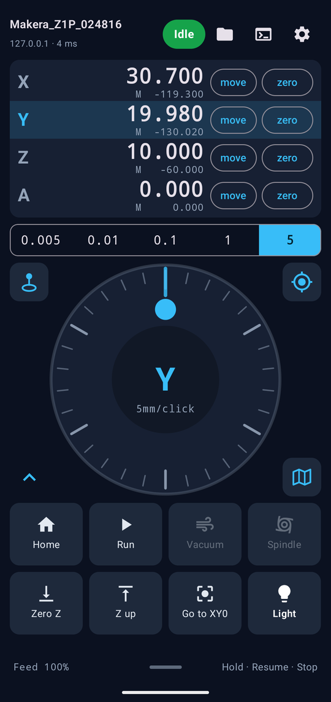
  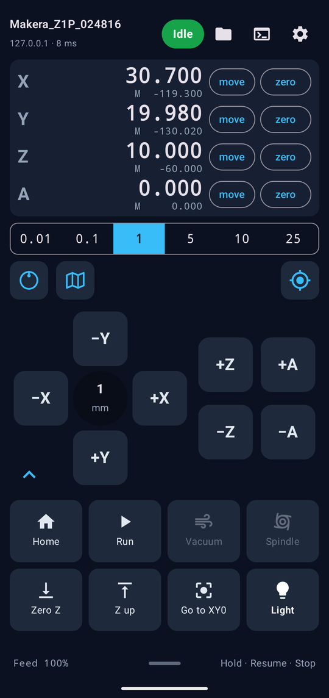
  
</p>

> **Not affiliated with Makera.** This is an independent, community project. It moves a real machine:
> keep your hand near the machine's own stop button, and use it at your own risk.

## Features
- **Handwheel**: drag around the dial; every click (12° by default) moves one step, with a vibration
  "detent" you can feel. The wheel turns in whole clicks under a fixed marker.
- **Jog pad**: tap the joystick button to swap the dial for a −X/+X/−Y/+Y pad with Z and A up/down.
  Tap for one step (it moves when you lift your finger), hold to keep moving at a steady speed;
  it stops when you let go.
- **Step sizes**: 0.005 · 0.01 · 0.1 · 1 · 5 mm on the dial; 0.01 · 0.1 · 1 · 5 · 10 · 25 mm on the pad.
  Each mode remembers its own step.
- **Live readout**: work position (large) and machine position (small) for X, Y, Z and A.
  - **move**: type a position (*Go to*) or a distance (*Move by*) and send it, with the exact G-code shown first.
  - **zero**: set the axis to 0. Press again before moving (it reads **undo**) to get the old value back,
    like a DRO's zero/recall. Settings can make it a 1.5 s hold instead of a tap.
- **Hotkeys**: your own buttons for built-in actions (home, unlock, zero, light, vacuum, feed…),
  G-code, or multi-step sequences. Optional "ask before running" and "only when Idle" guards.
  Bind any hotkey to a physical button: volume keys, Bluetooth remotes and gamepads, USB keyboards.
  Import/export the whole set as a file.
- **Feed override, spindle speed, Hold, Resume, Stop** in a drawer at the bottom (swipe up).
  - **−** / **+** step 5 % per tap (one command once you stop tapping; holding doesn't repeat), or
    drag the bar anywhere (the part past 100 % turns a darker blue); both send only when you're done.
    The spindle bar is in RPM (full = 13,000): while you drag, its label shows the RPM you'll get.
  - Tap the % for a small "Back to 100%?" prompt right on that row.
  - It opens by itself when a job runs, the machine holds or alarms, or something else moves it.
  - Hold, Resume and Stop stay quiet while idle and light up when they matter: Hold and Stop while
    moving, Resume on hold, Stop in an alarm. During a job, Stop reads **Cancel job**.
  - Resume also continues a job that the file itself paused (`M600`).
- **Files**: browse the machine's SD card, upload from your phone, rename, delete, and tap a file for
  its sheet: **Run**, and **Job info** (its tools and header). An upload can be cancelled at any point,
  and the machine then deletes the part it had received. On Android you can also send a file straight
  from another app (Files, Drive, Gmail): **Share → Z1 Pendant**, and the pendant asks before uploading it.
  Android's own file picker has no Cancel button; swipe in from the screen edge to back out of it.
  - **Move**: hold a file or folder to select it (tap more to add them), then drag onto a folder, or onto a
    folder in the path at the top. Long names work: the Z1 only takes short file commands, so the pendant
    moves a long one through a short temporary name.
- **Run a job**: the Run tile (or Run in a file's sheet) sets up and starts a job the way Makera Studio does.
  It only opens while the machine is Idle. A map of the bed shows the **cutting area** (the box the cutting
  moves cover), the origin, where the spindle is, the anchor bracket, the Z probe point and the leveling
  grid as you go, and warns if the job would run past the bed.
  1. **Origin**: keep the current zero, **Anchor 1** plus an offset (0, 0 is the bracket's inside
     corner), a **custom anchor** plus an offset, where the spindle is, or the **3D probe**: Next opens probing, and you can only go on once
     it has set an X/Y zero.
  2. **Checks**: Probe Z at start (required with Anchor 1), the margin scan (**Scan now**, and/or at the
     start of the job) and auto leveling (start height, edge inset, grid points). They start off on every
     run. All of them use the **laser probe**: the pendant swaps it in or measures it on the tool setter
     first, and only carries on when its length is the laser probe's. During the swap, the main button
     reads **Next** and continues it.
  3. **Assist**: auto vacuum, auto blow, bed clean, anti-static (they stay on in the machine).
  4. **Run**: the estimated machine time, the number of tool changes, each tool in the order it's used
     with its own time, the **precheck routine** (what runs before the first cut, if anything), origin
     and assist, then **Start job**. The old leveling mesh is always cleared first. It refuses a cutting
     area that runs past the bed, or a file that would cut before its first tool change.
  - **Leveling safety**: the grid keeps the inset in from the cutting area's edge (lead-ins and facing
    passes run past the stock), and each touch may only go 2 mm below the stock top (Settings → Run). A
    touch that finds nothing stops the job instead of running down to the vise.
  During the job, a **Mesh** chip in the job details opens this job's leveling grid as a heat map, and a
  popup says which tool to put in at each tool change (also after reconnecting), with Continue.
- **Running jobs** (from the pendant, Makera Studio, the Makera app, or the machine): the pill shows
  "Run 42%", and the drawer shows the progress and time left. A job started from the pendant opens the
  job details by themselves; swipe down for the slim line. The details: file, percent and line,
  elapsed, time left and finish time, feed and spindle actual vs set, the tool change it's waiting for,
  and the job's tools in order (with descriptions when the file's comments have them), now and next with
  when the next one is due.
  - Time left comes from the file itself: the pendant adds up every move at its feed (and the rapids),
    then follows how fast the machine is really going and your feed override. Times read like
    **13m 22s**, or **1h 05m** past an hour.
  - When the job ends, feed and spindle overrides go back to 100 % so they don't carry into the next job.
  - **Temperatures**: a graph of the spindle (blue) and the electronics box (violet) since the job
    started, each with the Z1's own limit (dashed / dotted) and the tool numbers along the bottom where
    each tool started, so you can see what each tool did to the heat. Within 5 °C of a limit, the line
    pulses, a banner says the Z1 will stop the job there, and the phone buzzes once.
- **Cancel job**: during a job the red button reads **Cancel job**. It sends the same halt as Makera
  Studio's Stop (it doesn't reset the machine), clears the alarm that follows, and takes you back to the
  main screen.
- **Leveling mesh**: a job's leveling mesh is cleared when the job ends or is cancelled (the Z1 otherwise
  keeps applying it to every move, jogs included). If the pendant connects and finds a mesh still loaded
  with no job running, it asks whether to **Clear** or **Keep** it.
- **Alarms**: if the machine goes into Alarm (e-stop, probe fail, soft limit…), a sheet says why and has
  **Clear alarm**. Tap the red Alarm status to open it again; the drawer shows the same strip. If a job
  was left open (after an e-stop), clearing the alarm ends it.
  - **Spindle overheated**: the sheet shows the job's temperature graph with the halt and the cooling
    since. Clear alarm waits until the spindle is back under the limit (above it, the Z1 would stop again).
  - **Spindle driver fault** (the driver board's own fault line, not the temperature): the sheet shows
    the temperatures and spindle speed just before it, and says the Z1 needs a power off/on.
- **Tablets** (iPad, Android tablets): a bigger readout, and the dial / jog pad resize around your
  hotkeys. Turn the tablet sideways for a side-by-side layout with everything on screen at once:
  readout, hotkeys and the stop buttons on the left, steps and a big dial or jog pad on the right.
- **Soft-limit protection**: jogs are clamped and typed moves refused before they reach the
  machine's soft limits, so they don't trip an alarm. The limits are read from the machine when it
  connects, so a Carvera Air gets its full travel.
- **Console**: every command sent and every reply, with time stamps, plus a box to type commands.
- **Machine name**: shows at the top even when you connect by IP address (read from the machine).
  Settings can hide its serial number, for screen recordings.
- **Update check**: when the app starts it asks GitHub whether there's a newer release and shows
  what's new. On Android, **Update** downloads it, checks it and installs it (Android asks you to
  confirm); on iPhone it opens the release page. Can be turned off in Settings.
- **Toggles that show state**: the Light and Vacuum tiles are bright when on, dim when off (read back
  from the machine).
- **Spindle**: the Spindle tile is dim while off; tap it for the start box (always asks): pick a preset
  (up to the Z1's 13,000 RPM max) or type an RPM. It remembers the last one. While it runs, the tile
  turns blue and shows the live RPM, also during a job; tap it to stop (it asks first, every time). It refuses to start with no tool or the probe loaded
  (the firmware would halt the machine) and offers a − T1 + stepper to set the tool number (no motion).
- Works alongside Makera Studio: both can be connected at the same time.
- **Bed map**: the map button (bottom-right of the dial, or beside the dial/jog pad switch) opens the
  machine's whole travel with a grid of points (5 × 5, 9 × 9 or 17 × 17), your anchors, X0 Y0, the tool
  setter and the spindle. Tap a point, an anchor or X0 Y0, then **Move here**: Z goes all the way up first,
  then X and Y. Turn **Safe Z** off to move at the height Z is at (sweeping a part with an indicator).
  Marks on the same spot (an anchor where X0 Y0 is) are drawn inside each other with both names.
- **Custom anchors** (Settings › Anchors): named points on the bed in machine coordinates (a vise jaw, a
  fixture plate), so they hold after every homing. Set one by probing a corner or an edge, from where the
  spindle is, or by typing it; **Re-probe** shows saved against measured. Run can use one as the job's
  origin, plus an offset; with a saved Z the job can skip its Z probe. Saved per machine on the phone; the
  Z1's own Anchor 1 (and the tool setter that hangs off it) is never touched.
- **Probing**: outside corner, inside corner, hole center, block center (round or square), Top only and
  edge, with the 3D probe, the probe rod (metal parts) or the laser probe (Top only).
  - Nothing but the probe is picked when probing opens: pick the operation, and each choice it needs
    appears in turn. **Move the probe into place** has the bed map, to get there quicker.
  - **Edge**: which edge, then **Touch the top first** (start over the part) or **Start from here** (the
    ball already beside the part at touching height: it goes straight in and backs off, Z never moves).
    **1 point** sets that axis's zero. **Multiple points** (2–8 over a total length) only measures: how
    far the edge is out of square (a best-fit line), and with 3 or more how straight it is, touch by
    touch. Every touch is checked against the machine's travel before it starts.
  - **Save as anchor** on the result: a name, and which of X, Y, Z to keep.
  - **Axes to probe**: X, Y and Z are toggles, all on each time probing opens; only the axes that are
    on are touched and set (a hole has no Z). With Z off it doesn't touch the top: it takes your current Z0 as the top and touches
    the sides that far below it, so set Z first (Top only does that). It won't start below Z0.
  - **Set work zero** runs Makera's own probing routine (`M480`), the same one Makera Studio uses,
    when the axes match one of Makera's (a corner with X, Y and Z, a hole, a block center with Z).
    Anything else, the pendant makes the touches itself and writes only the axes that are on.
    **Measure only** makes the same touches itself, changes nothing, and shows what it found; then
    set any of the axes as work zero, or leave it. Set work zero has an undo for X and Y.
  - Every time you open probing, the probe is calibrated on the tool setter first. It has to trigger
    there, so a dead probe or an unplugged cable is caught before it touches your part.
  - Each probe trips the setter at its own height, learned the first time you use it. If the probe
    in the spindle isn't the one you picked, it says which one is in and asks you to swap.

<p align="center">
  
  
  
  
</p>

<p align="center">
  
  
</p>

<p align="center">
  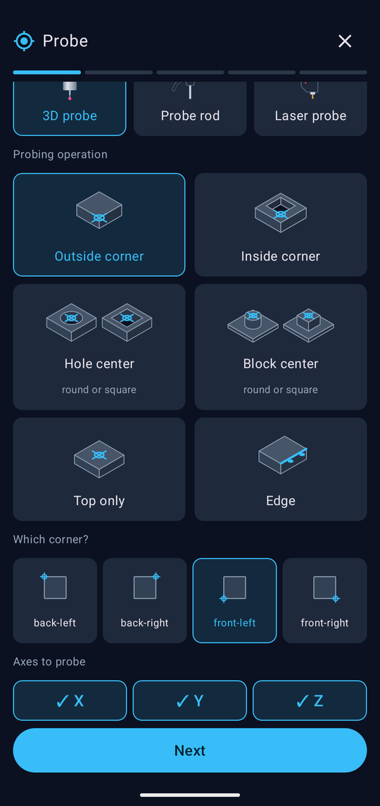
  
  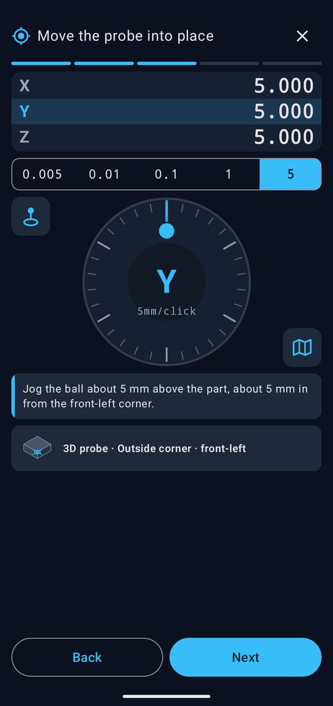
  
  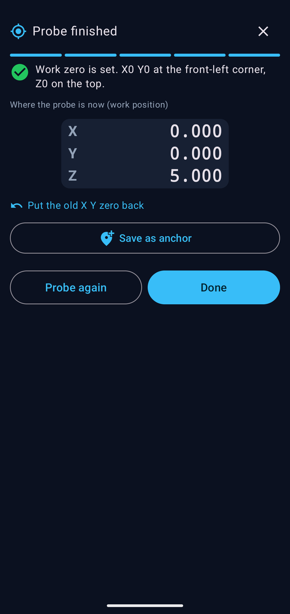
  <br><sub>Probing: pick the probe, the operation and the axes, check the probe, move it into place (the map button gets you there quicker), probe, result.</sub>
</p>

<p align="center">
  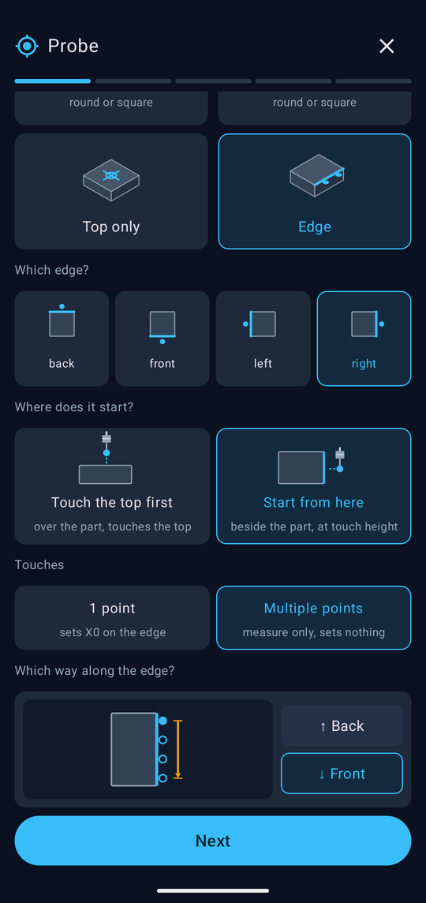
  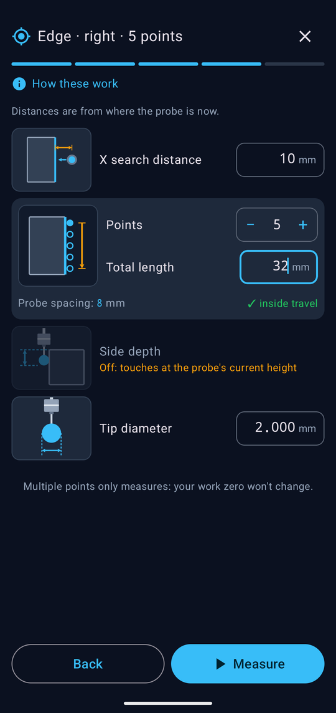
  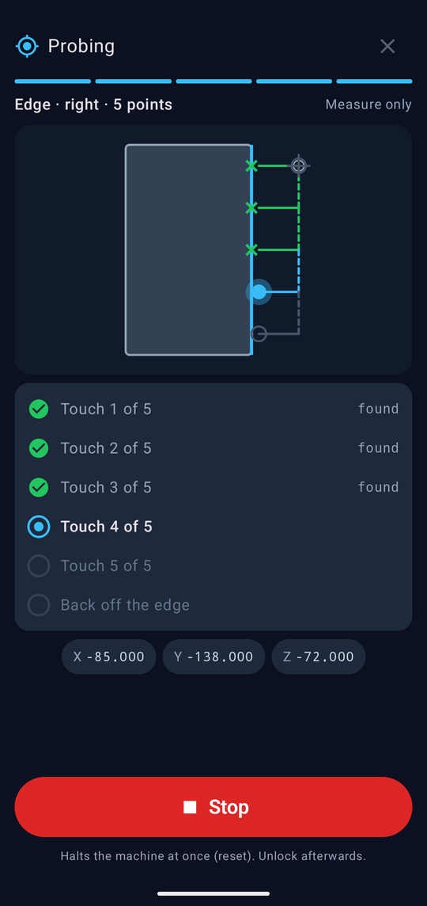
  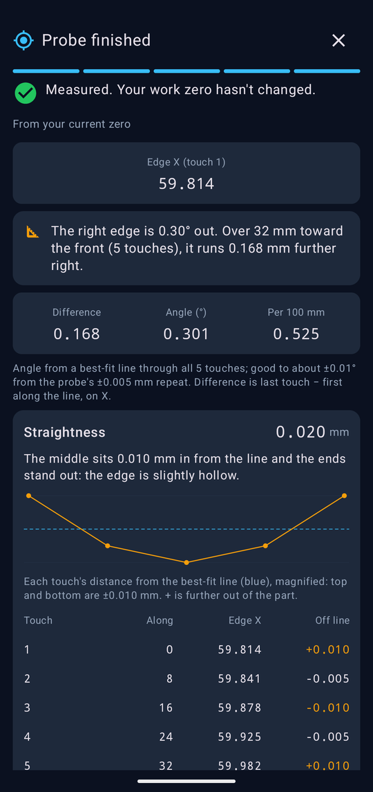
  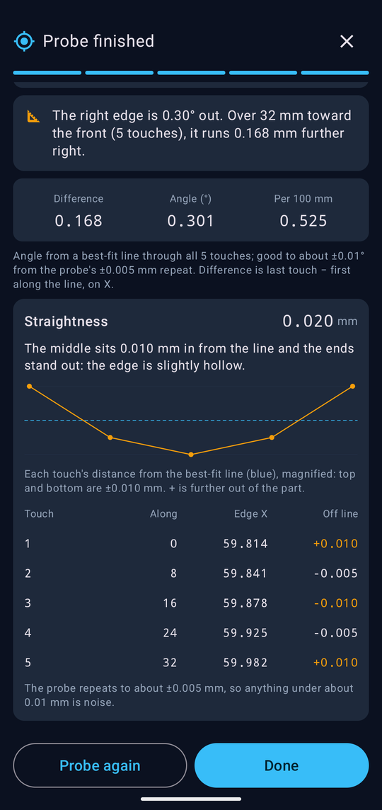
  <br><sub>Edge probing: started beside the part, five touches along the right edge, then how far out of square and how straight it is.</sub>
</p>

<p align="center">
  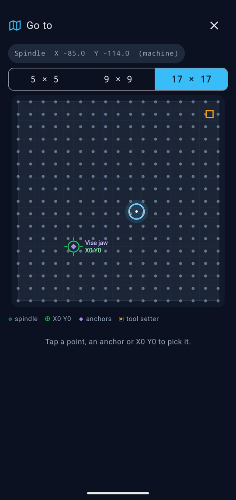
  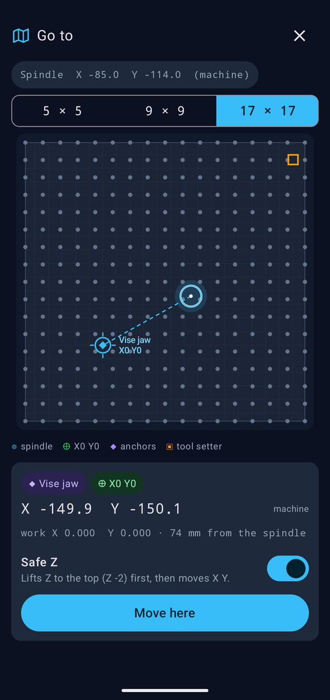
  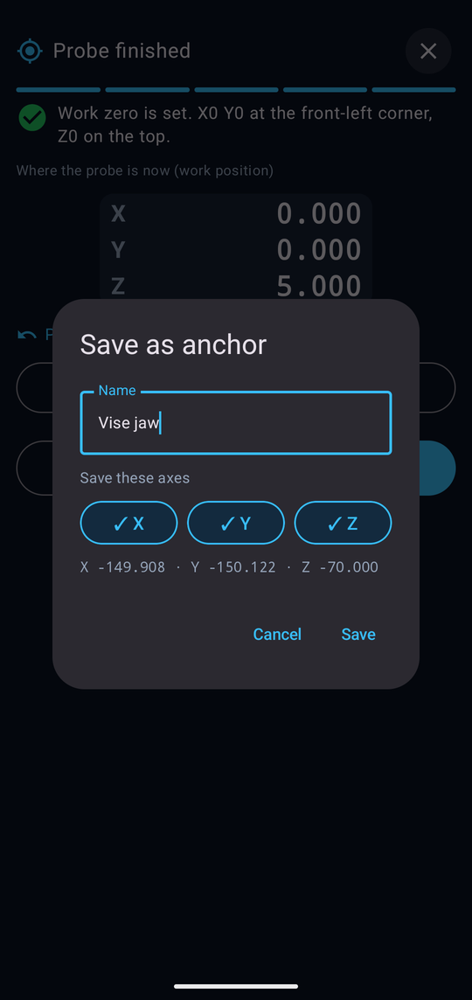
  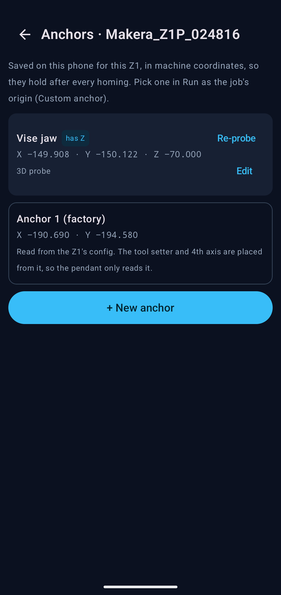
  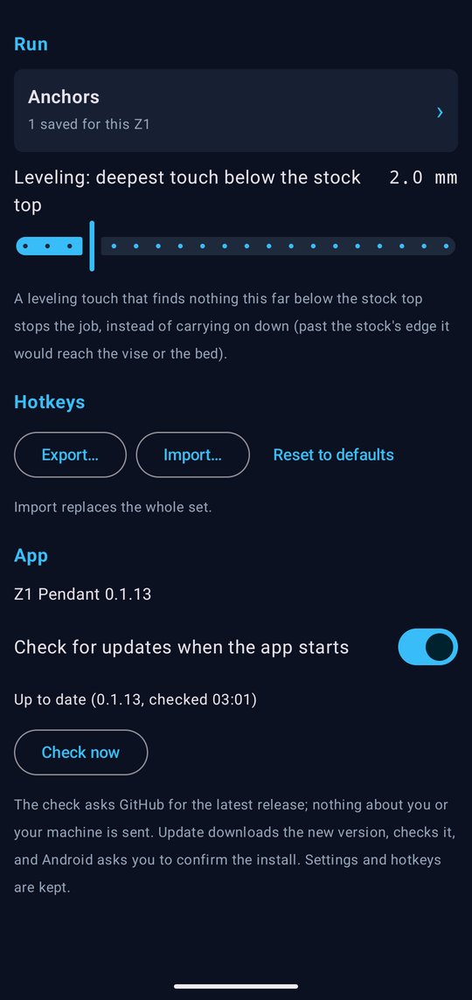
  <br><sub>The bed map, Save as anchor on a probe result, the saved anchors, and Settings with the update check.</sub>
</p>

<p align="center">
  
  
  <br><sub>A corner with Z off: the side depth counts from your Z0, and Start says so.</sub>
</p>

<p align="center">
  
  
  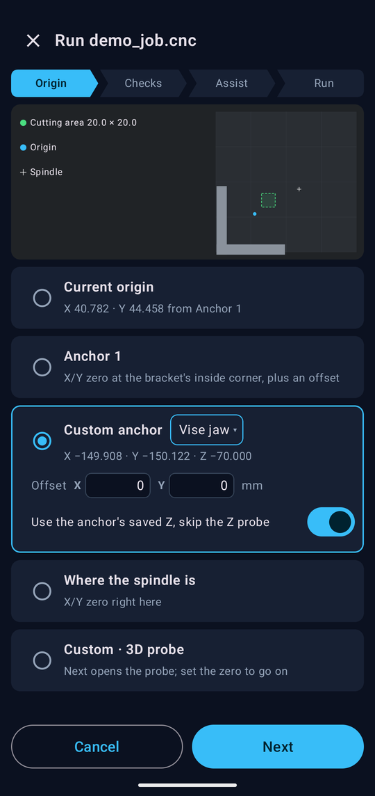
  
  
  <br><sub>Files and the upload sheet, then Run: the origin, the checks, and the summary with Start job.</sub>
</p>

<p align="center">
  
  
  <br><sub>A job running (with Cancel job), and the alarm sheet.</sub>
</p>

<p align="center">
  
  
  <br><sub>Temperatures: close to the limit during a job, and the overheat sheet after the Z1 stopped it.</sub>
</p>

<p align="center">
  
  <br><sub>A job running: overrides, the job details, the tool list and a tool change.</sub>
</p>

<p align="center">
  
  <br><sub>Spindle: start from the tile, adjust the speed in the drawer, stop.</sub>
</p>

## Requirements
- An Android phone or tablet on **Android 12 or newer** (developed on a Pixel 10, Android 16), or an
  **iPhone / iPad on iOS 16 or newer** that you install yourself from a Windows PC or a Mac (see
  [iPhone](#iphone); tested on an iPhone 16 with iOS 27 and an iPad Pro 11" with iPadOS 18).
- A **Makera Z1** (developed on a Z1 Pro) on stock firmware, already set up on your Wi-Fi with the
  Makera app.
- Phone and machine on the **same Wi-Fi network**.

## Install (Android)
The app isn't on the Play Store, so you install the APK file yourself ("sideloading"). It only takes a minute.

1. **Download the APK** on your phone: open the [latest release](../../releases/latest) and tap
   `z1-pendant-<version>.apk` under **Assets**.
2. **Open the downloaded file**: tap the download notification, or find it in **Files → Downloads**.
3. **Allow the install.** The first time, Android says your browser (or Files) isn't allowed to install
   apps. Tap **Settings**, turn on **Allow from this source**, then go back.
4. Tap **Install**. If Google Play Protect says the app is unknown, tap **More details → Install anyway**
   (it's unknown only because it isn't from the Play Store).
5. Open **Z1 Pendant**. No permissions to grant: everything it needs is allowed at install.

**Updating:** from 0.1.13 on, the app checks for a new release when it starts and offers it:
tap **Update**, and the app downloads it, checks it against GitHub's checksum, and Android asks you to
confirm. The first time, Android sends you to a page to allow Z1 Pendant to install apps: turn on
**Allow from this source**, come back, and tap **Update** again. **Settings › App** shows your
version, has **Check now**, and can turn the check off. The check only asks GitHub for the latest
release; nothing about you or your machine is sent. Older versions: install the newer APK the same
way as the first time. Either way your hotkeys and settings are kept.
**Removing:** long-press the app icon → **Uninstall**.

> Prefer installing from a computer? With [adb](https://developer.android.com/tools/adb) and USB
> debugging on: `adb install z1-pendant-<version>.apk`.

## iPhone
There's no App Store version, so you install the app yourself with your own (free) Apple ID, either
[from a Windows PC](#without-a-mac-windows) with no Mac needed, or by [building it on a Mac](#on-a-mac).
It's the same app and the same screens as on Android, and the same steps work for an iPad.

### Without a Mac (Windows)
Each [release](../../releases/latest) has a ready-built `z1-pendant-<version>.ipa` (the iPhone app,
not yet signed). [Sideloadly](https://sideloadly.io) signs it with your Apple ID and installs it over USB.

1. On the PC, install **iTunes from [apple.com](https://www.apple.com/itunes/)** (Sideloadly doesn't work
   with the Microsoft Store version) and **[Sideloadly](https://sideloadly.io)**.
2. Download `z1-pendant-<version>.ipa` from the [latest release](../../releases/latest) (under **Assets**).
3. Plug in the iPhone, unlock it, and tap **Trust**.
4. In Sideloadly: drag the `.ipa` in, pick your iPhone, type your Apple ID, and click **Start**. Enter
   your password and, if asked, the code Apple sends to your devices. A second (free) Apple ID works
   too if you'd rather not use your main one.
   - If it says the bundle ID isn't available, open **Advanced options** and change the **bundle ID**
     to something only you would use (e.g. add your initials at the end), then **Start** again.
5. On the iPhone: **Settings → General → VPN & Device Management** → your Apple ID → **Trust**.
6. The first time, iOS also wants **Developer Mode**: **Settings → Privacy & Security → Developer Mode**
   → on (the phone restarts, then confirm **Turn On**).
7. Open **Z1 Pendant** and tap **Allow** when it asks to find devices on your local network.

With a **free Apple ID the app stops opening after 7 days** (Apple's rule, whatever tool installs it;
a paid Apple Developer account makes it a year). Two ways to deal with it:
- **Let Sideloadly renew it:** in step 4, open **Advanced options** and tick **Automatic Refresh via
  Sideloadly Daemon**. It re-signs the app over Wi-Fi (or USB) before the week is up, as long as the PC
  is on with the Sideloadly daemon running (its icon in the taskbar tray).
- **Or redo step 4 by hand** each week with the same `.ipa` and Apple ID (and the same bundle ID, if
  you changed it).

Either way your settings and hotkeys are kept. To update to a new version, run step 4 with the new
`.ipa`. From 0.1.13 on, the app tells you when there is one (an iPhone app can't install its own
update): **Get the update** opens the release page, and **Settings › App** has **Check now**. ([AltStore Classic](https://faq.altstore.io/altstore-classic/how-to-install-altstore-windows)
is another free tool that does the same job.)

### On a Mac
Building with Xcode? **You don't need the `.ipa` file** from the release. Xcode builds the app from
the source code and installs it itself. The `.ipa` is only for installing without a Mac.

You need **Xcode** (free, Mac App Store) and **Java 21** (e.g. [Temurin](https://adoptium.net)),
and a USB cable for the first install.

1. Get the source: `git clone https://github.com/jimmyvegas29/makera-z1-pendant`
2. In Xcode: **Settings → Accounts → +** → sign in with your Apple ID. A free one works.
3. Plug in the iPhone, tap **Trust**, and turn on **Settings → Privacy & Security → Developer Mode**
   (the phone restarts).
4. Open `ios/iosApp.xcodeproj` in Xcode once: target **iosApp → Signing & Capabilities → Team** →
   your **(Personal Team)**. Note the 10-character team ID (`security find-identity -v -p codesigning`
   shows it in brackets).
5. Build and install: `ios/build_and_install.sh <TEAM_ID>`. (Or press ▶ in Xcode with the iPhone selected.)
6. On the iPhone: **Settings → General → VPN & Device Management** → your Apple ID → **Trust**.
7. Open **Z1 Pendant** and tap **Allow** when it asks to find devices on your local network.

With a **free Apple ID the app stops opening after 7 days**: plug the phone in and run step 5 again
(your settings and hotkeys are kept). A paid Apple Developer account makes it a year.

### Differences on iPhone
The volume buttons can't jog (iOS doesn't let apps use them), and hotkey
export/import is Android-only for now. **Scan network** works once you've allowed local network access.

## Connect to your machine
1. Turn the Z1 on and let it finish homing.
2. In the app, tap the **⚙ settings** icon (top right) → **Scan network**. Your machine appears as
   `Makera_Z1P_…`; tap it.
3. If it isn't found (some routers block broadcasts; on iPhone, check local network access is allowed
   under Settings → Privacy & Security → Local Network), type the machine's IP address and tap **Connect**.
   The IP is in the Makera app or your router's device list. The port is 2222.

The app remembers the machine and reconnects by itself. The name, IP and round-trip time show at the
top; the pill shows the machine state (Idle, Run, Hold, Alarm…). If the machine stops answering for
1.5 s, the pill says **No reply** and the app sends nothing until it answers again; after 25 s it
drops the connection and reconnects. If a command may still have been on its way when the machine
went quiet, the app drops the connection at once instead, so that command can't run later.

<p align="center"></p>

## Using it
**Readout**
- Tap an axis row to pick it for the dial (it highlights). Tap **move** to type a move.
- **zero** sets that axis's work position to 0; **undo** puts it back if nothing has moved since.
  With **Hold the readout's zero buttons** on (Settings), hold it 1.5 s (the row fills as you hold); a tap
  only says "hold".

**Dial**
- Drag your finger around the ring. Clockwise is +, counter-clockwise is −. Speed follows your hand.
- Volume keys jog ±1 click on the selected axis (can be turned off in Settings).

**Jog pad**
- Tap the joystick button (top-left of the dial). Tap the dial icon in the same spot to go back.
- Tap a button for one step; hold it to keep moving.
- The axis you jog on the pad becomes the selected axis, so the dial picks up where you left off.

**Jogging and the machine state**
- The dial and pad work while the spindle runs (the Z1 reports Run the whole time it turns).
- While a job plays, or while something else is moving the machine, they don't move it. A click that
  can't start within 1.5 s is dropped with a bump in your hand, never saved up to move later.

**Hotkeys**
- Tap a tile to run it. Hold a tile for 2 s to edit it.
- The **⌃** chevron (bottom-left of the dial) shows every hotkey. There, **+** adds one and **Edit**
  lets you drag tiles into a new order; tap **Save** when done. Hotkeys you've hidden from the grid
  (button-only) always sort after the visible ones.
- In the editor: pick a built-in action, write G-code (one command per line), or build a sequence
  (G-code, wait until Idle, delay, run another hotkey). **Bind a button…** then press any button on
  your phone, remote or gamepad. **Test run** tries it out.

**Bottom drawer**
- Swipe up on the handle at the bottom for Feed override, **Hold**, **Resume** and **Stop**.
- **Stop** (**Cancel job** during a job) asks first. It stops everything at once (Ctrl-X, the same as
  Makera Studio's Stop): motion and the spindle stop and a running job is cancelled. The pendant then
  clears the alarm for you, so you can move again. To pause and carry on, use **Hold**.

**Alarms**
- When the machine alarms, a sheet opens with the reason and **Clear alarm**. After an e-stop, release
  it first. Tap the red **Alarm** status any time to open the sheet again.

**Files** (folder icon next to the state pill)
- Tap a folder to open it, a file for its sheet (**Run**, **Job info**, **Rename**, **Delete**). Hold a
  file to select several. **Run** is off for the file the machine is playing, and while it isn't Idle.

**Console** (icon next to the state pill)
- Shows what was sent (→), the machine's replies (←), hotkeys run (▶) and a one-line summary of each
  jog. Type any command at the bottom.

**Probing** (target button, top-right of the dial)
1. **Probe**: pick the probe (3D probe, probe rod, laser probe) and the operation. The laser probe
   only senses straight down, so it can only do Top only; the probe rod only triggers on metal.
2. **Check the probe**: if the probe isn't in, **Load the …** runs the tool change (`M6 T9999`) and
   waits while you swap. Then it calibrates on the tool setter. It does this every time you open
   probing, because a probe can be swapped by hand without the machine knowing.
   - If the reading belongs to a different probe, it says which one is in. **Load the …** swaps in
     the one you picked; **Use the … instead** appears only if the probe that's in can do what you
     picked (all three can do Top only).
3. **Move the probe into place** with the dial or jog pad. The hint says where to park it.
4. **Settings**: start offsets (how far it moves out from where it's parked), side depth (below Z0 with Z off) and tip
   diameter, then **Set work zero** or **Measure only**. It asks once before it moves.
5. **Probing**: the touches as they happen. **Stop** halts the machine at once (then Unlock).
   **Result**: the new zero, or what was measured. **Probe again** keeps the calibration; a run
   that never touched anything asks for a new calibration, since the probe may be dead.

**Settings**
- Machine connection, hide the serial number, vibration strength, degrees per click, volume-key
  jogging, soft-limit clamping, hold-to-zero, keep screen on, the leveling depth limit (how far below the stock top a
  leveling touch may go, 2 mm by default), and hotkey export/import/reset.
- No vibration from the dial? The phone's **Use vibration & haptics** must be on (Settings → Sound &
  vibration → Vibration & haptics). **Touch feedback** can stay off on Android 13 and newer.

## Build from source
The full source is here. Make it your own.

- **App** (`android/`): Kotlin + Compose Multiplatform. Almost everything (UI, jog engine, protocol)
  lives in `android/shared` and runs on both platforms; `android/app` is the Android shell and `ios/`
  the iPhone shell (see [iPhone](#iphone)). Open `android/` in Android Studio, or with JDK 21 and the
  Android SDK installed:
  ```bash
  cd android
  ./gradlew assembleRelease        # Windows: gradlew.bat assembleRelease
  ```
  The APK lands in `android/app/build/outputs/apk/release/`. Builds are signed with your local debug
  key, so an APK you build can't update one installed from the releases page (uninstall that first).
  For the same reason the in-app **Update** won't install a release over an app you built yourself (it
  says so). The version number lives in `android/gradle.properties` (`pendantVersionName`/`Code`).
- **Python tools** (`python/`, Python 3, no extra packages):
  - `z1sim.py`: a machine simulator. Point the app at your computer's IP to try everything with no machine.
    `z1sim_probe.py` adds a part on the table for probing, and the sim keeps an SD card folder for Files.
  - `z1client.py`: a command-line client (discover, read status, send a line).
  - `z1upload.py`: send a file to the machine's SD card over Wi-Fi, or fetch one back (`test_z1upload.py`
    runs it against the simulator).
  - `fsprobe.py`: prints the Wi-Fi board's raw replies to file commands (research tool).
  - `z1proto.py`: the protocol code, with a self-test.

How it works under the hood (protocol, jog engine, what's been confirmed on a real Z1):
[docs/DEVELOPMENT.md](docs/DEVELOPMENT.md).

## License
[MIT](LICENSE): use it, change it, share it, even sell it. Just keep the copyright notice and
license with it, so the original work gets credit.
